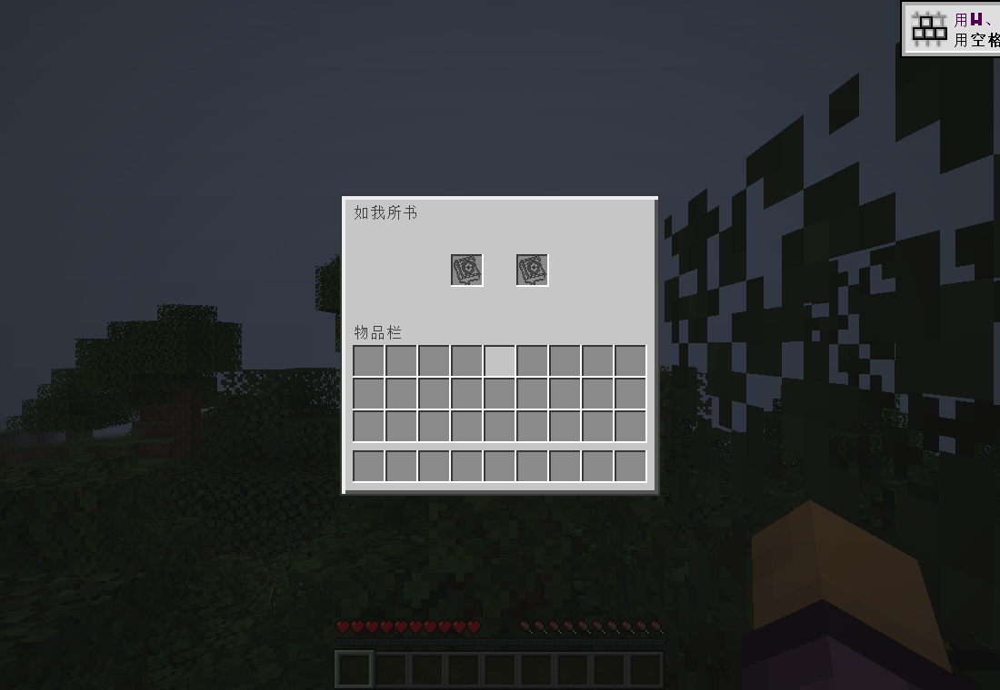
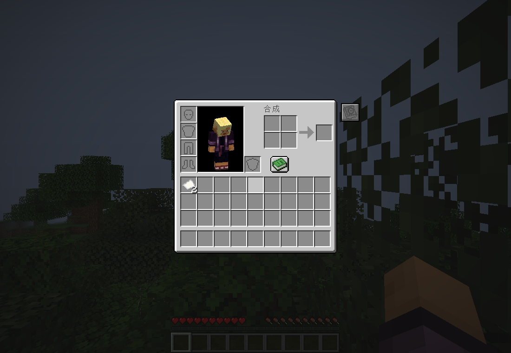
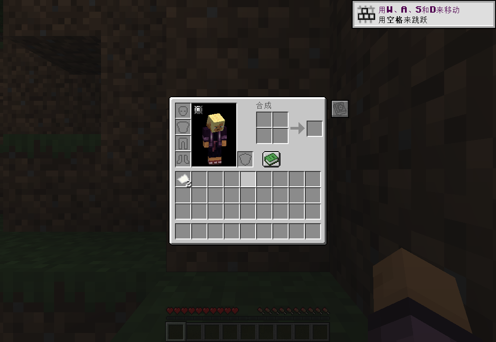

# 独立如我所书饰品栏 · 1.20.35

Minecraft Java 1.20.1 / Forge 47.4.0+ / Java 17。槽位、存储、网络菜单与客户端界面均由本模组提供，无需 Curios。

## 使用

进入世界即拥有两个「如我所书」专属槽。在游戏中按 J，或点击生存/创造背包右侧的书本按钮打开；按键可在控制设置中更改。每槽最多一件，支持 Shift 快速装备及取下。保留 1.20.34 的原书本透明线稿图标。

装备保存在玩家的 `starcrowndoll:as_written` Forge capability 中，退出重进保留。正常死亡掉落并清空槽位；启用 `keepInventory` 时保留，玩家克隆时复制，包括死亡重生与末地返回。

联机时客户端、服务端均使用 1.20.35；网络协议由 5 升为 6。正式 JAR 不依赖或捆绑 Curios。关闭游戏后替换旧版以神戴冠 JAR，避免同时安装多个版本。

## Curios 共存范围

安装 Curios 时，它自己的饰品界面仍可使用，并新增本模组书本入口，打开同一组独立槽。取消旧版的 Curios 槽位定义，避免产生另一组「如我所书」槽。

本版识别新标签 `starcrowndoll:as_written_accessories` 和旧标签 `curios:starcrowndoll_as_written`。这里的兼容是界面共存和物品标签兼容，不向 Curios API 暴露这两个独立槽，不自动运行第三方 Curios 饰品回调。

本次只提供槽位框架。「如我所书」饰品本体、配方、能力仍待后续制作；现有玩偶维持头部穿戴方式。正式物品标签只预留可选的 `starcrowndoll:as_written`，当前没有可装备的正式物品。

## 实现与验证

`AsWrittenInventory` 管理固定两槽 capability、NBT、克隆、死亡事件和服务端打开请求。`AsWrittenMenu` 使用服务器权威的原版容器点击及同步协议，管理两槽和玩家的 36 格物品栏。客户端通过 `AsWrittenClient` 注册 J、书本按钮和屏幕。图标通过原版 blocks atlas 的 single source 加载，不依赖 Curios 图集扫描。

离线构建通过。独立 GameTest 服务端的 59 项测试全部通过，其中新增五项覆盖：

- 固定两槽、普通物品拒绝、每槽数量限制、玩家 ForgeCaps 存储和 NBT 恢复。
- Shift 双向转移、物品数量守恒与自定义 NBT。
- 原玩家 capability 失效后的克隆恢复，复制后的数据相互独立。
- 正常死亡事件每件只掉落一次，重生不复制已掉落物。
- keepInventory 死亡事件与克隆保留装备。

使用独立工作目录、复制测试世界和生产映射 JAR，启动实际 Forge 47.4.26 客户端进行以下验收，未修改用户正式实例或存档：

| 环境 | 已通过的检查 | 记录 |
| --- | --- | --- |
| 不安装 Curios | 图集加载、背包按钮、J 触发实际打开网络包、两槽同步、真实点击包装备/取下、数量与 NBT、按钮重开 | [首次运行](as-written-standalone-1.20.35/without-curios-results.txt) |
| 不安装 Curios，完整退出后重进同一世界 | 槽内物品与 NBT 从磁盘恢复，重新打开后同步到客户端 | [重进记录](as-written-standalone-1.20.35/without-curios-reload.txt) |
| 同时安装 Curios Forge 5.14.1+1.20.1 | 同样的存取与网络测试、Curios 自身界面、Curios 中书本按钮、无重复专属槽 | [共存记录](as-written-standalone-1.20.35/with-curios-results.txt) |

装备测试使用 QA 包专用标签临时允许纸张，正式包不包含该标签覆盖或 QA 类。死亡与克隆分支由服务端 GameTest 调用事件验证；客户端实测覆盖存取、同步、界面和真实退出重进。尚未验证未来饰品能力及其他版本的 Curios。

