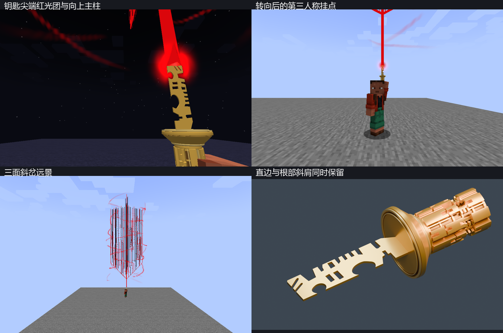

# 王律之键与乖离剑 1.20.52

本版校直钥匙长板外边，保留齿槽、孔洞以及根部向内斜肩。可编辑 Blender 源文件在 `models/fate/Bab_ilu.blend`。

长按王律之键时举钥匙朝上，尖端产生红色能量光团，中心光柱从球心向上生长，再展开三面斜岔。第三人称取实际物品握把矩阵，第一人称使用同一握把变换绘制钥匙和计算尖端。解析塔保持世界竖直，随玩家转向和手的位置更新，不再使用启动脚下或前方固定点。环绕风压继续由程序着色器生成。

光团使用独立发光目标、半分辨率分离模糊和深度约束合成，只有光团参与此泛光；不是整屏亮度阈值。不宣称照亮附近方块。Fabulous 模式保留核心光团但跳过此后处理，第三方光影组合未认证。

成功长按 8 秒后，EA 替换使用中的钥匙，钥匙不返还、不掉落；取消保留钥匙。EA 从创造分类和搜索隐藏。保留已有金色亮面、伸手、黑面、交叉白光、黑面碎裂、取剑时序及基础近战；未加入蓄力大招。管理员命令仍可用于调试注册物品。

## 验证

- Forge 1.20.1 / 47.4.0、Java 17；6 项服务端 GameTest 通过，覆盖成功消耗、取消、满背包、提前完成、换栈及副手使用。
- 隐藏测试客户端使用 RTX 4060 Laptop GPU，实际主手夜景、副手白天取剑均成功；实际资源重载后正常。
- 检查创造分类及搜索集合均无 EA，完成后背包无王律之键；所有记录的截图帧 GL=0。
- 实际画面检查第一人称尖端连续连接、第三人称转向、远景 V 分岔；54/55 tick 分别关闭/开启 Bloom（不同时间帧，不作为严格像素差分）。
- Blender OPTIX 正面和斜视检查：直边与斜肩并存；参考存在透视，不声称逐像素完全一致。
- 最后补充非施法手过滤、移动距离裁剪与异常降级保护；这些保护通过最终编译，未另外扩大实机组合验证范围。

完整实机记录见 [client-results.txt](fate-key-ea-1.20.52/client-results.txt)。原生方块手臂没有手指骨骼。
