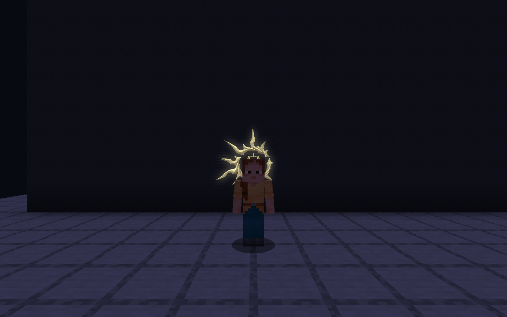
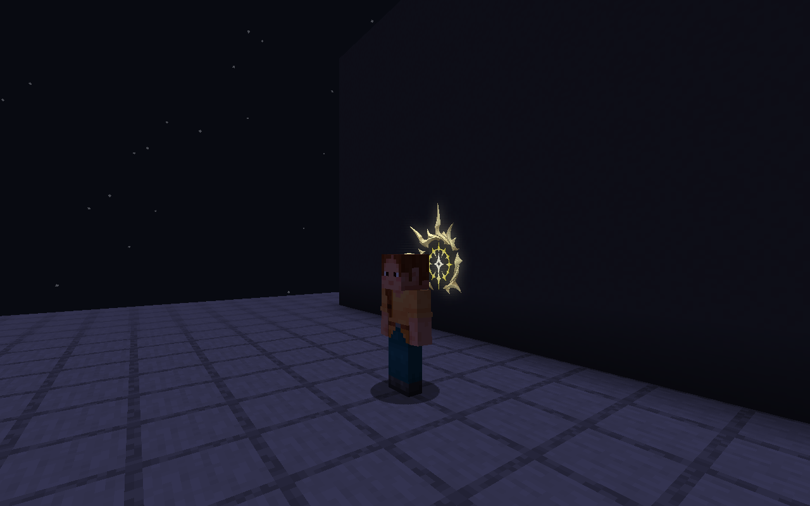
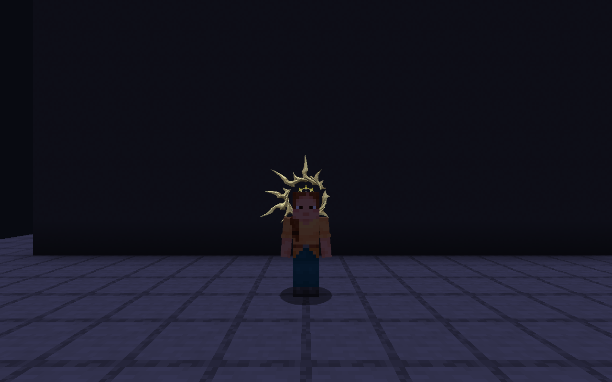

# 永劫回归：脑后悬浮神环（1.20.48）

佩戴神环放大到原 1.20.47 的 2.08 倍（比例 0.72 → 1.50），移至身体坐标后方 0.67 格，带 ±0.018 格的缓慢上下浮动。挂点改用身体骨骼和实体根朝向，独立转头、抬头和低头不再带动神环；转身和身体姿态仍会带动它。

保留原高清三角模型、UV 和金色纹理，佩戴显示内外双环。回归时仍使用原版图腾动画与高清内环，物品图标和玩法未改。

## 泛光实现

- 只捕获实际佩戴神环的三角形，重放到独立发光缓冲；不提取场景中的其他亮物。
- 保留全亮基础模型，金色纹理亮部向外扩散。半分辨率执行两组横纵高斯模糊，再以 0.85 强度叠加到原画面。
- 使用场景深度检测与 32 位浮点发光深度元数据，限制泛光穿过前景身体、墙体；不改写主场景深度。
- 一帧合成一次，可收集多个佩戴者；尺寸变化重建缓冲，资源重载和退出世界释放 GPU 资源。
- 在地形裁切层之后开始收集，兼容低视距跳过天空绘制的情况。异常只关闭泛光，保留基础神环。

这是屏幕柔光，不会给周围方块添加动态照明。泛光范围为世界中的佩戴神环；物品栏及回归动画不执行该屏幕效果。Fabulous 或使用外部主帧缓冲的渲染管线会保留基础神环并跳过本泛光，未认证 Oculus/Iris 光影。

## 构建与实机验证

JDK 17 / Minecraft 1.20.1 / Forge 47.4.0 源码构建；正式包执行 `reobfJar`。QA 为独立模组，不进入正式 JAR。

```powershell
./gradlew.bat --offline --console plain -Pqa build qaJar
```

后台 GPU 客户端：Forge 47.4.26、Curios 5.14.1、GeckoLib 4.8.4-mesh.9、NVIDIA GeForce RTX 4060 Laptop GPU。隔离存档使用正式重映射 JAR，通过 `enable-halo-float-qa` 启用实际世界测试。

实机结果见 [client-results.txt](client-results.txt) 和 [release-audit.json](release-audit.json)。通过正面/侧面、独立转头、泛光开关、墙体遮挡、资源重载、尺寸变化、取下、Curios 隐藏、实体隐身以及 GPU 缓冲释放重建检查；`restored` 截图同时检查正常 HUD。服务端玩法未修改，本轮不重复认证其他模组的玩法兼容性。








