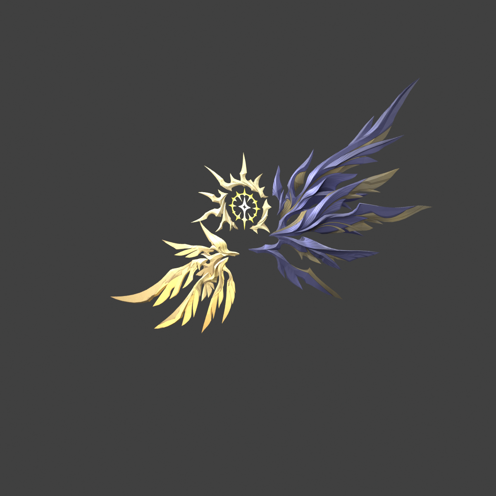
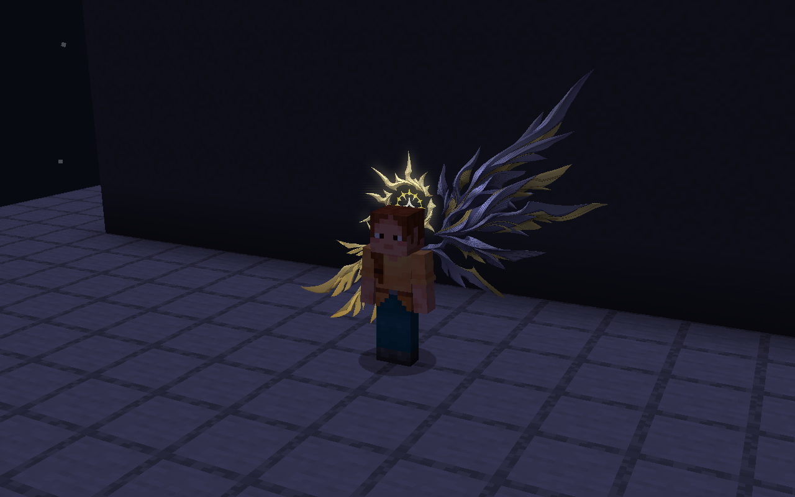
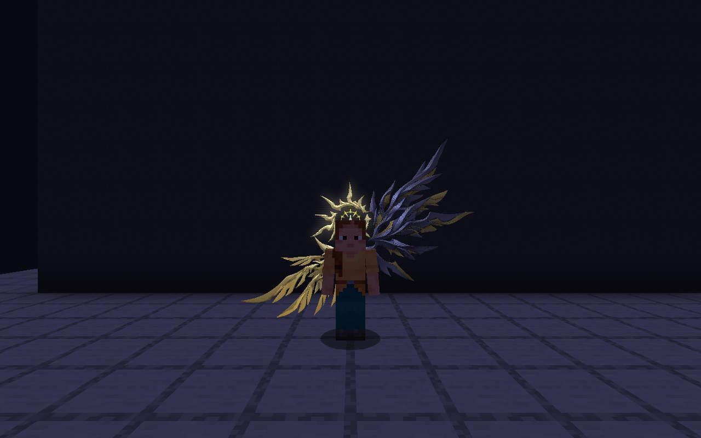
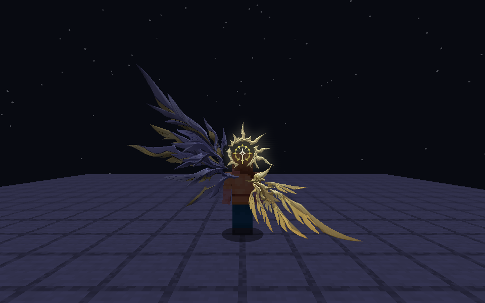

# 永劫回归：原始双翼与神环整组适配（1.20.49）

佩戴 `starcrowndoll:eternal_return` 时自动显示高清神环与原始双翼，取下、隐藏饰品或隐身时整组隐藏。沿用原三角 Mesh 与原 4096×2048 RGB 贴图；金色下垂左翼和深紫金色上扬右翼保持原有不对称姿态。

## 原模型对应与用户标注修复

参考为白厄变身完整模型及用户圈出的神环右侧、紫翼根部。原始模型 `Avatar_Phainon_10_Model_Others` 的 `Body_wings` 同时包含神环和双翼：`WingIn*` 属于神环，`WingL*`、`WingR*` 属于两翼，均位于 `Root_M` 层级下。

早期组合预览中，神环单独放大到 1.50，双翼为 1.00，导致圈出的局部投影挤在一起。最终版本对整组使用统一的 **1.083** 比例，并保留原始身体坐标、前后方向和相对位置。根据原角色约 1.85 米的上部身高适配原版模型约 2 米的绘制高度，后续由原版 PlayerRenderer 同时缩放玩家与附件。神环中心锚点由上一版的 Y=-0.32 改为约 -0.465，较前版略微上移。

统一挂点计算：`Y = 1.501 - 1.8155191 × 1.083`，`Z = 0.31046635 × 1.083`。前者抵消原版身体模型的脚底偏移，后者使用原神环中心的后向坐标。源 `(x,y,z)` 转为 Minecraft 模型 `(x,-z,y)`，使原模型后方与玩家后方一致。神环和双翼共用身体姿态与浮动相位，独立抬头、低头和左右转头不带动它们。

整组保留原绑定姿态；本版没有提取或虚构原游戏的扇翼动画。原 FBX、骨架和顶点权重仍在本机解包参考工程中，运行网格按原绑定姿态保存。原版图腾回归动画继续只显示内环，双翼只进入佩戴层。金色屏幕泛光继续只从神环提取，双翼不进入发光源。

## 逐面核对

| 部件 | 原始顶点 | 三角面 |
|---|---:|---:|
| 内环 | 1085 | 920 |
| 外环 | 1782 | 1700 |
| 左翼 | 2735 | 2974 |
| 右翼 | 2748 | 3147 |
| 合计 | 8350 | 8741 |

将正式运行网格逆变换回原模型坐标后，逐一匹配全部 8,741 个源三角面的位置与 UV，最大误差为 5.96×10⁻⁸。原神环与右翼最近顶点距离约 0.05324 米，统一转换保留其空间关系，未将翼根合并到神环。完整结果见 `source-assembly-validation.json`，源顶点索引与骨骼分组见资源中的 `eternal_wings.json`。



## 构建和实机

Java 17、Forge 47.4.0 源码构建，正式 JAR 完成 reobf。隔离客户端 Forge 47.4.26 + Curios 5.14.1 + GeckoLib 4.8.4-mesh.9，使用 NVIDIA GeForce RTX 4060 Laptop GPU；Blender 参考验证使用同一 GPU 的 OptiX，未切换用户窗口。

```powershell
./gradlew.bat --offline --console plain -Pqa build qaJar
```

独立 QA 使用 `enable-halo-wings-qa`，补充图腾界面与参考相机使用 `enable-halo-gap-qa`。正式包不含 QA。证据见 `client-results.txt`、`gap-results.txt`、`release-audit.json` 及本目录原始游戏截图。验证覆盖正面、转头、侧面、背面、蹲伏、取下、隐藏、隐身、泛光开关、墙体遮挡、资源重载、尺寸变化和缓冲重建。







Fabulous 和外部光影主帧缓冲仍使用原有泛光降级策略；未认证 Oculus/Iris、第三方玩家模型和多人渲染。玩法未改，本轮不重复认证其他玩法功能。
