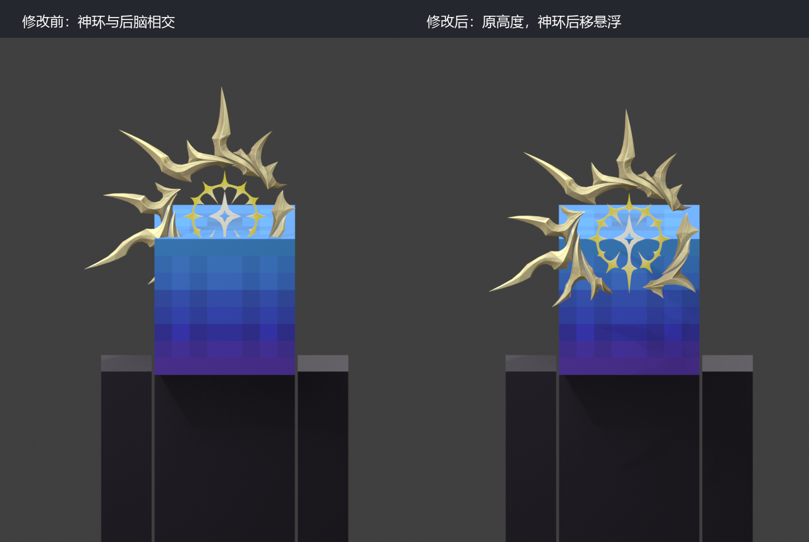

# 神环位置与摸鱼神性攻击修复

基于 1.20.44 / `5259255`，修订为 1.20.45。

## 神环

佩戴变换由 `(0, -0.56, 0.22)` 改为 `(0, -0.56, 0.55)`，缩放保持 `0.72`。只沿头部局部后方移动0.33格，高度不变，随头部转动。神环模型最近一面位于局部 Z≈0.529，头部外层背面为 Z=0.28125，留出约0.248格空气间隙。背面观看时，神环不会再埋进后脑；仍遵守正常深度遮挡，从正面观察时不强制穿透头部。

只改 Curios 佩戴位置，物品栏图标、内环回归展示、模型网格与贴图均沿用1.20.44。

对比图用实际神环网格、贴图和提供的角色皮肤离线渲染。位置关系可核对，画面光照和材质不代表 Minecraft 实机效果。

## 摸鱼神性

`PlayerGuard` 的玩家攻击入口还保留了旧宽容规则：只要佩戴余乐玩偶，就在原版 `Player.attack` 开头直接取消。移除此分支，恢复头盔槽与神格槽佩戴时的近战攻击。

宽容的和平领域、友好生物无害化、受击转化为双方恢复/吸收保留；其余神性、常规原版攻击规则与成然权柄逻辑继续生效。

回归用例在 `tools/qa/runtime/java/dev/starcrownqa/YuleAttackRegressionTests.java`：实际原版近战调用、头盔/神格两种装备位置、安抚后的目标、脱下玩偶、箭矢伤害和宽容受击保护。

## 验证

独立 Forge 47.4.0 GameTest 服务端实际执行3项用例，结果 `All 3 required tests passed`。覆盖头盔槽近战、安抚后的目标、脱下后的近战，神格槽近战与箭矢伤害，以及受击取消和双方生命恢复/伤害吸收。

正式 JAR 完成编译与重映射，ZIP完整性通过；无QA类，Mixin引用类齐全，打包后的PlayerGuard中已无旧YuleTolerance攻击拦截引用。佩戴高度、缩放保持原值，模型最近面与头发外层的后向间隙约0.248格。

没有启动图形游戏客户端，神环位置检查使用离线几何对比，未将其标为游戏内渲染验收。
