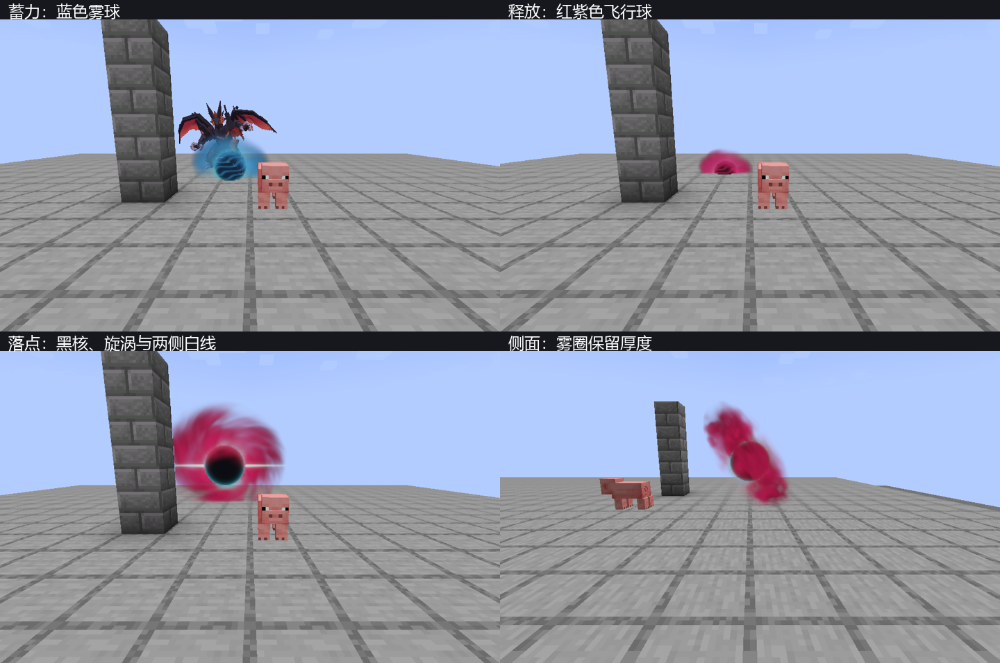

# 1.20.53 合并与荒芜之噬检查

合入主分支 a48e3d4 的荒芜之噬 LITE 浓雾旋涡，以及王律分支 aa381f4 的武器、取剑与尖端泛光。生产渲染源码保持各自实现，版本统一为 1.20.53。主分支正式 1.20.51 包保留原位置，王律分支同号历史包保存在 releases/fate-preview-1.20.51。

当前默认效果为蓝色蓄力雾球、红紫飞行球、黑核与红色旋涡落点，两侧有白色延伸线。侧面能看到雾圈厚度。落点十秒后收缩，配合服务端爆发显示消散球。默认 LITE / 0.5 比例 / 360000 像素预算，亦可配置 LEGACY、BASIC 或 OFF。

本次在隐藏开发客户端运行合并后的生产源码，Minecraft 1.20.1、Forge 47.4.0、Java 17、RTX 4060 Laptop GPU，960×600。11 个固定阶段/视角调用生产绘制，随后检查真实服务端漩涡。共 63 项运行时检查通过，覆盖 GL 状态、移动、转向、近裁剪、尺寸调整、像素预算、资源重载、故障降级、恢复、关闭和退出清理。正式 JAR 构建及 reobfJar 成功，验证同时含两组代码和资源，不包含 QA 类。本次画面来自源码开发客户端，不冒充正式混淆包的再次运行。

飞行阶段截图用固定实体位置展示着色器，球体被测试地面截断；不代表真实投射物飞行轨迹。侧面雾气和细边仍比正面柔软。本次只合并并检查，未重新设计效果，也未验证第三方光影或 Fabulous。

| 场景 | 原生体积 ms | 半宽高 ms |
| --- | ---: | ---: |
| landing-close | 0.8494 | 0.5750 |
| landing-far | 0.2857 | 0.2621 |
| charge | 0.5908 | 0.6707 |
| released | 0.3635 | 0.3558 |
| near-clip | 2.5923 | 1.0122 |
| ground-silhouette | 0.5586 | 0.5156 |
| side | 0.6764 | 0.5478 |
| above | 1.5391 | 0.8822 |
| behind | 0.7859 | 0.5110 |
| collapse | 0.3543 | 0.2683 |
| burst | 0.2499 | 0.2406 |

计时仅含此特效的生产绘制、深度与合成，不代表整游戏 FPS。

SHA-256：`7a624eaa11cd3dff97abc5187e3637baf89ea96d07a94dc25b0d4a6dfdbc0aab`
