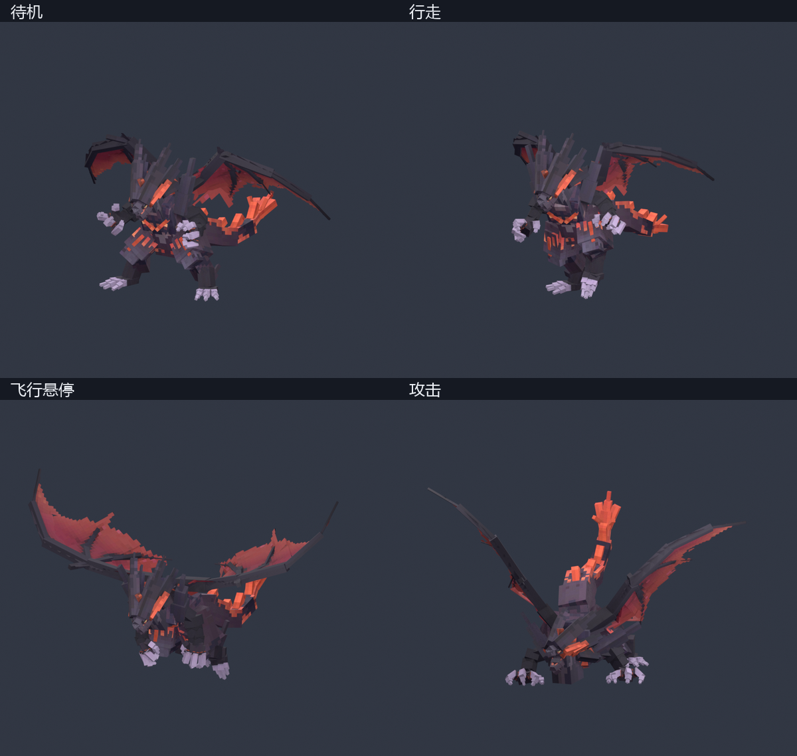

# 冥古龙最新模型

[下载最新模型整包](https://github.com/hbyaing/SUIYUESHISHU/raw/refs/heads/main/models/minggulong/MingGuLong-Latest.zip)

最新交付版本为 2026-11-12 的原始动作骨骼版，基于手臂与手脚修订后的模型。整包约19 MiB，包含完整模型本体、内嵌贴图与动画，可直接在 Blockbench 打开，不需要另外寻找基础模型。

- `MingGuLong-Rigged-Core.bbmodel`：同一模型，21段常用动作，适合编辑。
- `MingGuLong-Rigged.bbmodel`：同一模型，106段完整动作，包含技能分段及剧情动作。
- 动作清单、骨骼绑定清单、姿态预览和使用说明。

模型采用250个Cube、原始100骨骼与48个翼膜辅助驱动，贴图2048×2048且内嵌。极端折翼仍有分片接缝；技能分段需要后续状态机衔接，尚未与荒芜之噬特效绑定。

[查看独立模型文件和详细说明](rigged/README.md)
