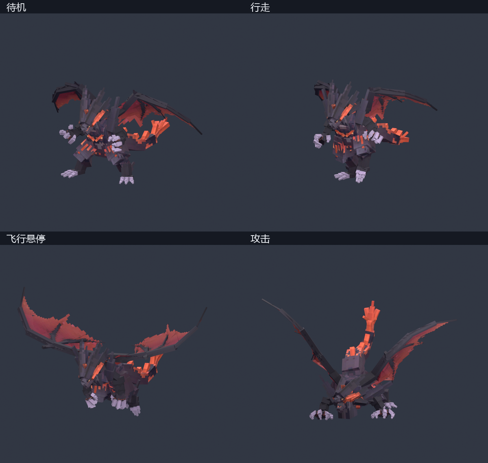

# 冥古龙 · 原始动作骨骼版

基于手臂修订版绑定原始冥古龙骨架，并从本机已安装客户端导出 106 段动作。动作保留原资源名称、时长与帧率。下颌、头颈、四肢、指爪和尾巴分别绑定。

[下载常用动作工程](MingGuLong-Rigged-Core.bbmodel) · [下载完整动作工程](MingGuLong-Rigged.bbmodel)

这是可编辑骨骼模型与动画资源，尚未接入主模组的实体状态机。完整工程约85.3 MiB，打开与切换动作可能需要等待；常用动作工程约23.2 MiB。GitHub不提供此格式的在线模型预览，可通过文件页的下载按钮获取。

已上传的[荒芜之噬特效工作台](../../../tools/minggulong-huangwu-vfx/README.md)为独立演示，尚未与本工程联动；目前也未确认原资源中哪套 Skill 分段对应「荒芜之噬」。

## 打开方式

在 Blockbench 打开 MingGuLong-Rigged-Core.bbmodel，点击右上角「动画模式」，选择左侧动作，按空格播放。

- MingGuLong-Rigged-Core.bbmodel 包含 21 段常用动作，适合日常编辑。
- MingGuLong-Rigged.bbmodel 包含 106 段完整动作，其中包括剧情动作和原始分段技能。
- animation-list.json 列出了每段动作的资源路径、时长、帧率及是否为叠加动作。
- rig-manifest.json 列出了 Cube 与原始骨骼的对应关系。

两份工程使用同一套绑定和贴图。主要动作名称如下。

| 动作 | 资源名称 |
| --- | --- |
| 待机 | World_Idle |
| 行走 | World_Walk |
| 奔跑 | World_Run |
| 起飞 | World_Fly_Start |
| 悬停 | World_Fly_Hover |
| 滑翔 | World_Fly_Gliding |
| 降落 | World_Fly_Landing |
| 地面攻击 | Fight_Attack_1、Fight_Attack_2 |
| 空中攻击 | Fly_Attack_1、Fly_Attack_2 |
| 受击 | Fight_Hit_1、Fight_Hit_2、Fight_Hit_3 |
| 死亡 | Fight_Die |

## 骨骼与验证

工程为 Modded Entity 格式，使用 250 个 Cube、原骨架 100 骨和 48 个翼膜辅助驱动。原 204 块模型中的两片整翼膜拆成了 48 片，以配合翅膀弯折。贴图内嵌，分辨率 2048 × 2048，UV 坐标范围 512 × 512。

原骨骼关键帧与源动作做了数值抽查，抽查动作包括待机、行走、奔跑、飞行和攻击。压缩后抽查点的最大旋转差为 0.833°，最大位置差为 0.293 个模型单位，约 0.0183 个 Minecraft 方块。另检查了模型分组、UV、106 段动作的引用、时间范围和关键帧数值。常用动作工程已在 Blockbench 打开，并实际播放检查了待机。

Cube 采用刚性绑定，翼膜采用分片拟合。极端折翼仍可见分片接缝，与原游戏蒙皮网格有差异。剧情动作保留原始位移。技能的 Start、Loop、End 段需要由后续模组状态机衔接。模型与动画可继续在 Blockbench 编辑，游戏内触发逻辑需要在模组中接入。

原资源由本机客户端离线导出，UE Viewer 工具资料见 https://www.gildor.org/smf/index.php?topic=9182.0 。本包保留原角色与素材的权利归属。
