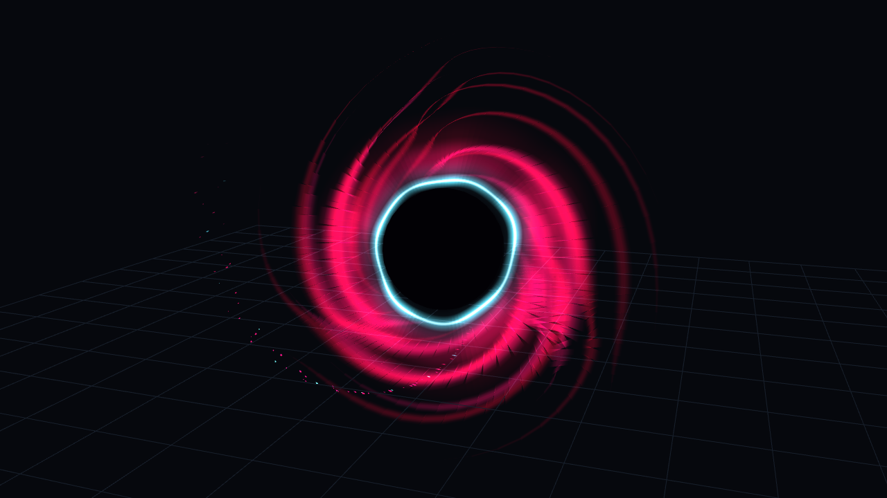

# 冥古龙 · 荒芜之噬特效第一版

Minecraft Java 1.20.1 / Forge 47.4.0+ / Java 17。

本目录包含程序特效源码、可单独触发的 Forge JAR、交互工作台、正速/半速视频及阶段截图。特效时长 4.32 秒，依次为蓝白聚能、红紫旋涡与暗核、核心收缩闪爆、蓝白/粉红碎晶消散。



## 打开工作台

安装 Node.js 18 或更新版本后，双击 `preview/Start-Preview.cmd`。也可运行：

```sh
node preview/serve.mjs --open
```

服务只监听本机，自动选择空闲端口，并打开浏览器。关闭服务窗口即停止。工作台使用 WebGL 2 和浏览器 DecompressionStream；新版 Chrome / Edge 均支持。

拖动旋转视角，滚轮缩放，时间轴逐帧查看，按钮暂停/播放。工作台读取 Forge 几何生成器导出的109帧，不播放一张旋涡贴图。工作台中的网格地面仅作空间参照，不包含在游戏特效中。直接用 file:// 打开 HTML 无法正常读取压缩几何，请通过上述本地服务打开。

## 游戏内预览

`dist/MingGuLong-Forge-1.20.1-1.1.0-vfx.jar` 属于独立 `minggulong` 演示模组，包含原有静态龙展示实体。它不是以神戴冠主模组的升级包。已有旧版 `minggulong` 演示模组时请替换旧 JAR，避免重复 modId。

客户端命令：

- `/huangwu`：在视线命中的方块上方播放一次；没命中时在前方9格放置固定中心。
- `/huangwu loop`：同一中心循环预览。
- `/huangwu time 1.5`：固定到指定秒，范围 0—4.32；再次 `/huangwu` 恢复正常播放。
- `/huangwu off`：关闭。

只有客户端视觉，不造成伤害，不移动/吞噬生物，不同步其他玩家。未绑定冥古龙骨骼、技能按键或命中事件。渲染中心固定在世界坐标，切换世界会清除；实体与地形参与深度遮挡，绘制后恢复渲染状态。当前版本使用几何软边与叠加发光，不包含真实场景折射、屏幕 Bloom 或动态光照。

## 源码与重建

- `forge-1.20.1/`：可独立构建的演示模组完整源码与 Gradle wrapper。
- `HuangWuGeometry.java`：确定性几何和时序，无 Minecraft 依赖，时间单位为秒，坐标单位为方块。
- `HuangWuClient.java`：客户端命令、固定中心和世界渲染。
- `scripts/HuangWuExport.java` 与 `scripts/rebuild-preview.mjs`：从同一 Java 几何生成器重建工作台帧，运行 `node scripts/rebuild-preview.mjs`。

构建 JAR：在 `forge-1.20.1` 目录执行 `gradlew.bat --console plain build`。

## 验证及边界

Forge 编译及 reobfJar 通过；工作台浏览器检查无页面错误、WebGL error=0；109帧几何全部为有限数，透明度范围0—1，结束帧无残留顶点。最复杂帧约26262个三角形。仅保留单个客户端预览实例，持续播放会逐帧生成几何，尚未在游戏中测量性能。

本轮未启动 Minecraft，截图和视频来自读取同源几何的独立 WebGL 工作台，不是实机验收截图。工作台不复现 Minecraft 光影、雾和第三方渲染管线。视觉第一版是参考重制，尚不等于原游戏特效的逐像素还原。

## 参考来源

[4399 S5新技能展示](https://www.4399.com/pcgame/topic/54549421.html)的“荒芜之噬”条目。原动图显示技能卡和完整施法过程；网页及游戏美术权利属于各自权利人。此处特效几何为本次重新编写，参考媒体未作为运行时贴图使用。Forge 工程中的原有龙模型与贴图沿用先前模型展示工程，其美术来源归原权利人。
